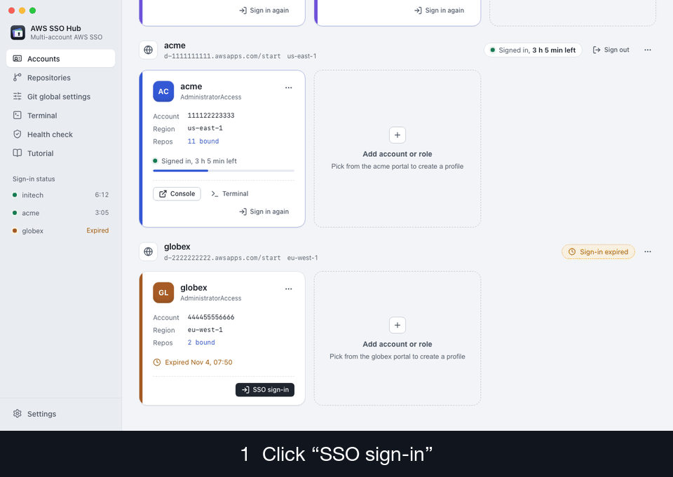
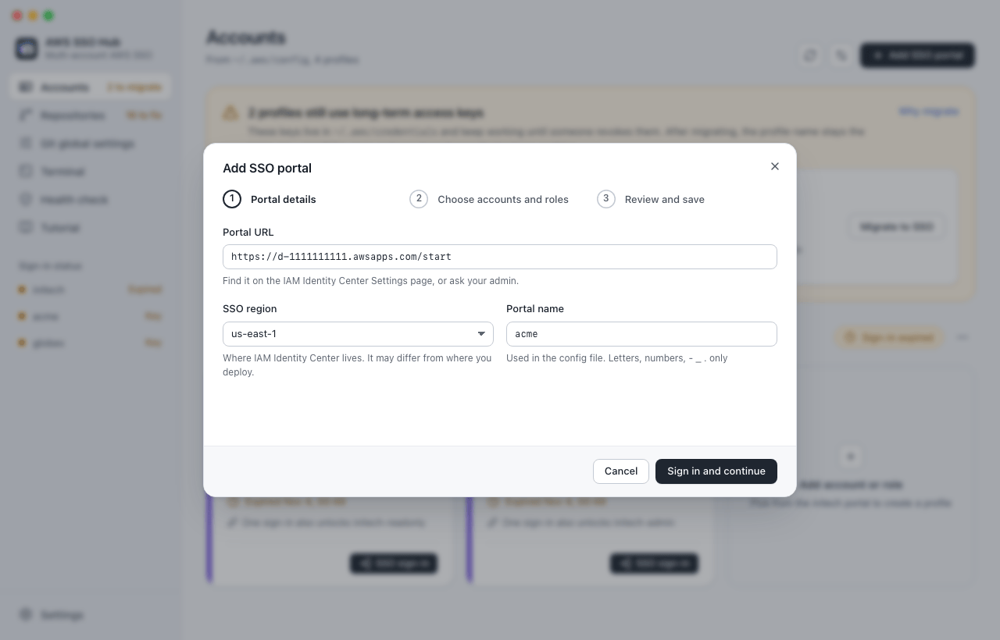
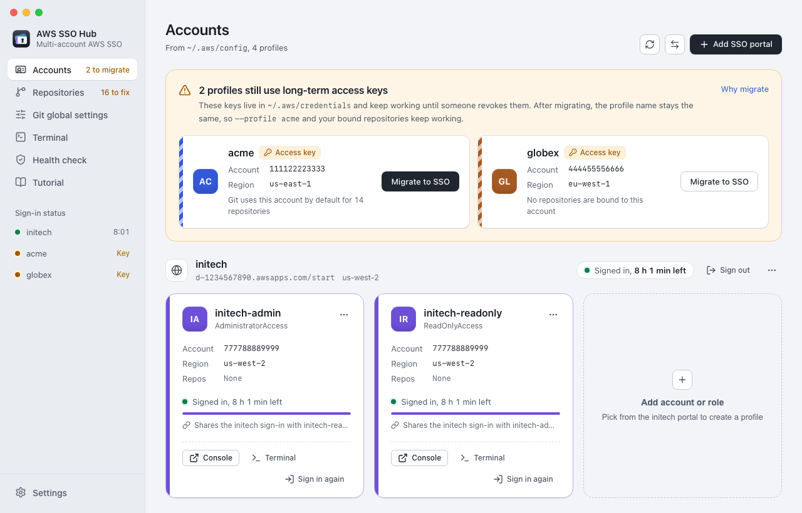
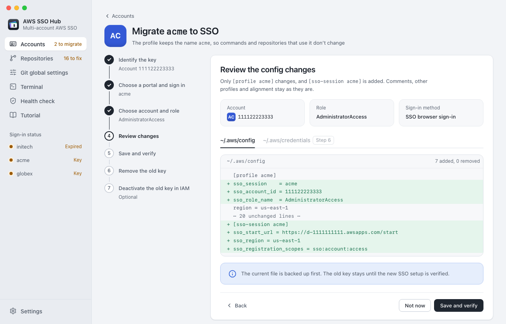
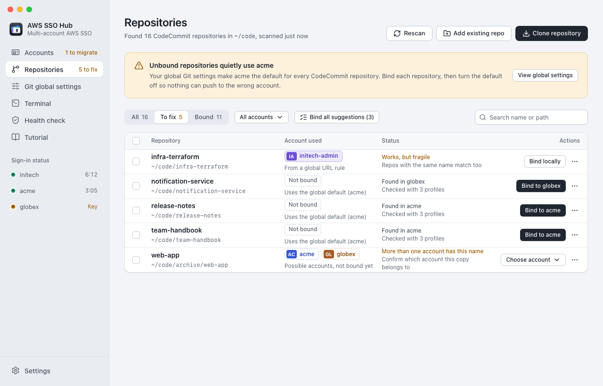

# AWS SSO Hub

**English** | [简体中文](README.zh-CN.md)

[](https://github.com/rudian/codepass/releases)
[](LICENSE)


A desktop app for macOS and Windows that signs you in to all your AWS IAM Identity Center (SSO) portals with one click, keeps every CodeCommit repository on the right AWS account, and gets long-term access keys off your disk.



📖 **[Illustrated step-by-step guide](docs/guide.md)** covering every screen.

## Why

- **Access keys never expire.** A key in `~/.aws/credentials` works for anyone who gets a copy, until someone revokes it. SSO gives out short-lived credentials instead.
- **Several companies, several AWS accounts.** With several portals and CodeCommit repositories in different accounts, it is easy to push with the wrong one. AWS SSO Hub binds each repository to its own account and tells you when it can't.
- **One screen instead of many commands.** No more hand-written `aws configure sso`, `aws sso login --profile ...` and `.git/config` edits. Every change is shown first and backed up.

## Features

- **One SSO sign-in button per portal**, with a live countdown of how long the session lasts. One sign-in unlocks every profile of that portal.
- **The sign-in survives quitting the app.** It is stored where the AWS CLI keeps it, so `git` and `aws` keep working with the app closed.
- **Sign-in opens in a private browser window** (on by default, where your browser supports it), so an earlier web session is never reused: password and MFA every time, and nothing stays signed in after you close the window.
- **Migrate access-key profiles to SSO and keep their names**, so `--profile acme`, scripts and repositories keep working. The wizard verifies the new setup before it removes the old key, then helps you deactivate it in IAM.
- **Per-repository CodeCommit binding with automatic account detection.** Two clones of the same repository can use two accounts.
- **Add an existing repository** from any folder, and **bind all suggestions** in one go.
- **Clear Git messages:** when you are not signed in, Git says so instead of asking for a password.
- **Export and import** portals and profiles as JSON, without keys or tokens.
- **Git global guard:** stops unbound repositories from silently using a default account.
- **Backups before every change**, without key values, with one-click restore.
- English and Chinese interface, light and dark theme.

## Get started in 5 steps

**0. Install.** Download the zip for your system from [Releases](https://github.com/rudian/codepass/releases). On macOS, drag **AWS SSO Hub.app** to Applications; the app is not notarized, so right-click it and choose **Open** the first time. On Windows, run **AWS SSO Hub.exe**; if SmartScreen warns you, choose **More info**, then **Run anyway**.

**1. Add your SSO portal.** On **Accounts**, choose **Add SSO portal** and paste the portal URL your administrator gave you (`https://d-xxxxxxxxxx.awsapps.com/start`). Then pick the accounts and roles you want; each one becomes a profile in `~/.aws/config`.



**2. Sign in with one click.** Choose **SSO sign-in**. Your browser opens; sign in and choose **Allow access**. The app shows how long the session has left.



**3. Move old access keys to SSO.** Choose **Migrate to SSO** on a profile that still uses a key. The wizard shows the exact change, verifies it, and then removes the key.



**4. Bind your repositories.** On **Repositories**, the app suggests the right account for each repository. Choose **Bind all suggestions**, or bind them one by one.



**5. Work as usual.** `git pull`, `git push` and `aws --profile acme ...` just work until the session ends, even with the app closed. When the session has ended, Git tells you plainly:

```text
AWS SSO Hub: cannot get CodeCommit credentials for AWS profile 'acme' (not logged in, session expired, or AWS CLI missing). Click 'SSO sign-in' for this profile in AWS SSO Hub, or run: aws sso login --profile acme
```

The [illustrated guide](docs/guide.md) covers the rest: the migration wizard step by step, adding and cloning repositories, Git global settings, export and import, settings, and troubleshooting. The app also has a built-in **Tutorial**.

## Requirements

- macOS 13 or later (Apple Silicon or Intel), or Windows 10/11 x64 with the WebView2 runtime (included in current Windows).
- [AWS CLI v2](https://docs.aws.amazon.com/cli/latest/userguide/getting-started-install.html) 2.22 or later, for Git and the `aws` command. Signing in works without it.
- Git 2.39.1 or later.
- An AWS IAM Identity Center **organization instance** with a permission set assigned to you. If your company does not have one yet, the [guide](docs/guide.md#1-before-you-start) shows the administrator steps. If each of your companies has its own AWS Organization, each one becomes its own portal in the app.

To check a download, compare it with `SHA256SUMS.txt` from the release:

```sh
shasum -a 256 -c SHA256SUMS.txt --ignore-missing
```

## How it works

- **Compatible with the AWS CLI.** Portals are saved as `[sso-session]` blocks in `~/.aws/config`, and the sign-in goes into `~/.aws/sso/cache` in the same format the AWS CLI v2 uses. `aws sso login` and AWS SSO Hub share one sign-in either way.
- **Per-repository credential helper.** Binding a repository writes a helper for the CodeCommit host into that repository's own `.git/config`. It runs `aws codecommit credential-helper` with the right profile, plus a final helper that prints the message above instead of a password prompt.
- **Signing out really signs out.** It removes the portal's sign-in and also the AWS CLI's cached role credentials for that portal (`~/.aws/cli/cache`).
- **Nothing secret is stored by the app.** No passwords, keys or tokens of its own; its settings hold preferences only.
- **Backups** of `~/.aws/config`, `~/.aws/credentials` and each `.git/config` it changes, with key values removed: `~/Library/Application Support/AWS SSO Hub/backups` on macOS, `%AppData%\AWS SSO Hub\backups` on Windows.

## Security and privacy

- Talks only to AWS (IAM Identity Center, STS, IAM, CodeCommit) and, through Git, to your own repositories. No telemetry, no analytics, no update checks.
- The sign-in callback listens on `127.0.0.1` only, with a one-time state check and a short timeout.
- Runs only `aws`, `git` and, when you ask, your terminal app, always with argument lists and never through a shell string. Opens only `https://` links.
- Testing a repository's connection never runs commands from that repository's own Git settings.
- AWS SSO Hub is a convenience tool, not a security boundary: anything that can read your home folder can also read the AWS CLI's sign-in cache. Use disk encryption and a screen lock.

Found a vulnerability? Please report it privately, see [SECURITY.md](SECURITY.md).

## Build from source

You need Go 1.26 or later, Node.js 26 or later, and the Wails v3 CLI:

```sh
go install github.com/wailsapp/wails/v3/cmd/wails3@v3.1.0
```

```sh
# macOS app (Apple silicon, macOS 15 or later); needs the Xcode command line tools
wails3 task darwin:package   # -> bin/Codepass.app

# Windows x64 (cross-compiles from macOS, or builds on Windows)
wails3 build GOOS=windows GOARCH=amd64    # -> bin/codepass.exe

# development with live reload
wails3 dev
```

Tests: `go test ./...`, and in `frontend/`: `npm test` and `npm run typecheck`.

The frontend can also run in a normal browser with a built-in demo backend and made-up data, which is how the screenshots were made: in `frontend/`, run `npx vite` and open the printed address with `?scenario=mid&page=accounts`.

## Project layout

```text
main.go              application entry, window and services
internal/api         data types and error codes shared with the frontend
internal/app         services exposed to the UI, tray, background tasks
internal/accounts    portals, profiles and sessions
internal/sso         browser sign-in, token cache, sign-out
internal/awsconfig   editing ~/.aws/config and ~/.aws/credentials
internal/ini         comment-preserving INI reader and writer
internal/migrate     access key to SSO migration
internal/repos       repository discovery, account detection, binding
internal/gitx        Git commands and credential helpers
internal/gitglobal   global Git settings and saved passwords
internal/transfer    JSON export and import
internal/backup      redacted backups and restore
frontend/            React + TypeScript UI, translations, demo backend
build/               platform build files and icons
docs/                illustrated guide and screenshots
```

## Contributing

Issues and pull requests are welcome. Please keep changes focused, add tests, and use only made-up example data (such as `acme`, `globex`, `initech` and account `111122223333`) in code, tests and screenshots. Never post real account IDs, keys or tokens in an issue.

## License

[Apache License 2.0](LICENSE). Third-party components and their licenses are listed in [THIRD_PARTY_NOTICES.md](THIRD_PARTY_NOTICES.md).

## Disclaimer

Not affiliated with or endorsed by Amazon Web Services. AWS is a trademark of Amazon.com, Inc. or its affiliates.
