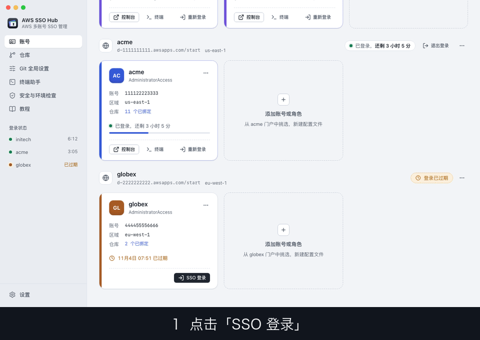
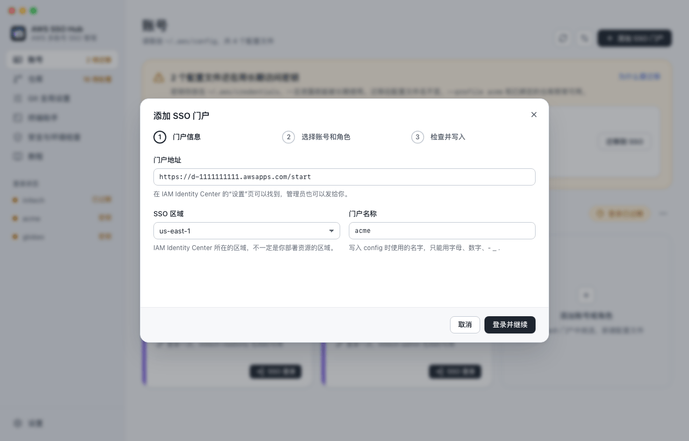
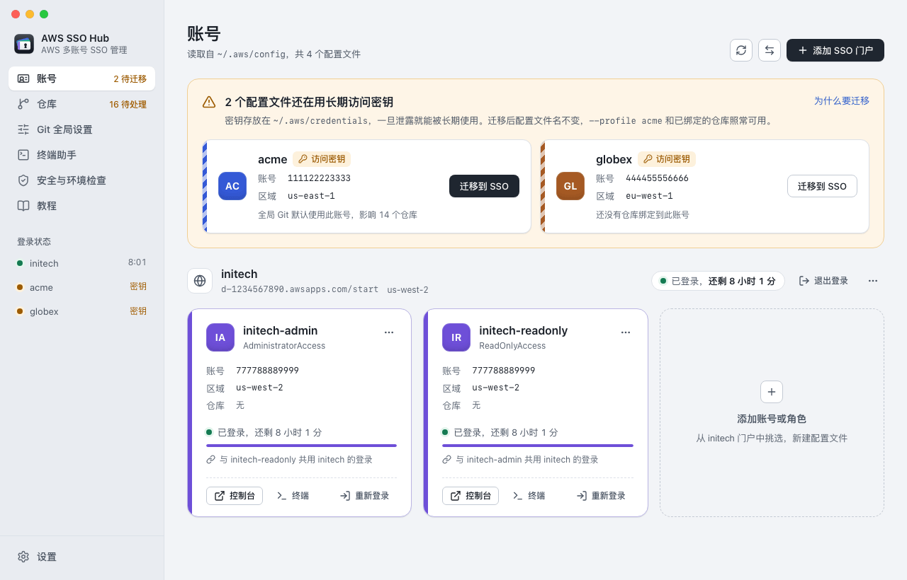
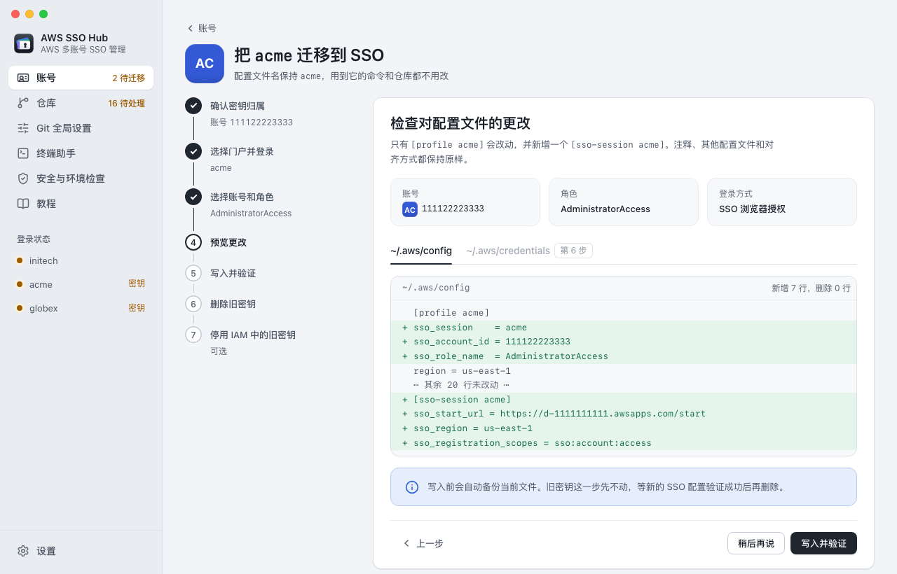
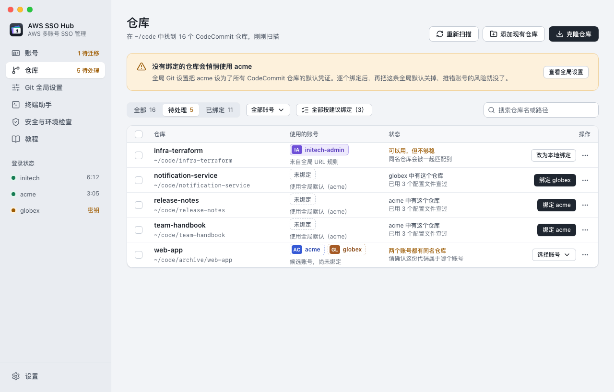

# AWS SSO Hub

[English](README.md) | **简体中文**

[](https://github.com/rudian/aws_sso_hub/releases)
[](LICENSE)


一个 macOS 和 Windows 桌面应用：一键登录你所有的 AWS IAM Identity Center（SSO）门户，让每个 CodeCommit 仓库自动用对 AWS 账号，并把长期访问密钥从电脑上清掉。



📖 **[图文教程](docs/guide.zh-CN.md)**：每个界面一步一步讲清楚。

## 为什么需要它

- **访问密钥永不过期。** `~/.aws/credentials` 里的密钥，谁拿到一份拷贝谁就能用，直到有人手动吊销。SSO 发的是短期凭证，到期自动失效。
- **多家公司，多个 AWS 账号。** 门户一多，CodeCommit 仓库又分散在不同账号里，很容易用错账号推代码。AWS SSO Hub 把每个仓库绑定到它自己的账号，绑不上时会明确告诉你。
- **一个界面代替一堆命令。** 不用再手敲 `aws configure sso`、`aws sso login --profile ...`，也不用手改 `.git/config`。每次改动都会先给你看，并自动备份。

## 功能

- **每个门户一个 SSO 登录按钮**，实时显示会话还剩多久。登录一次，这个门户下的所有配置文件都能用。
- **退出 app 不会退出登录。** 登录信息存在 AWS CLI 存放它的地方，关掉 app 后 `git` 和 `aws` 照常能用。
- **每次登录都用一个单独的新无痕窗口**（默认开启，支持 Chrome、Edge、Brave 和 Chromium）：不会沿用其他用户之前的登录，登录结束后 app 会自动关掉这个窗口。其他浏览器在 app 能打开无痕窗口时用无痕窗口（比如 Windows 上的 Firefox），否则用普通窗口。
- **把访问密钥迁移到 SSO，配置文件名保持不变**，`--profile acme`、脚本和仓库都不用改。向导先验证新配置能用，再删除旧密钥，还会帮你在 IAM 里停用它。
- **每个仓库单独绑定 CodeCommit 账号，并自动识别归属账号。** 同一个仓库的两份拷贝可以用两个不同的账号。
- **添加现有仓库**：任意文件夹都能加进来；还能**一键按建议绑定**全部仓库。
- **git 提示清楚：** 没登录时，git 会直接告诉你，而不是让你输密码。
- **导出 / 导入** 门户和配置文件（JSON），不含任何密钥或令牌。
- **Git 全局防护：** 防止没绑定的仓库悄悄用上某个默认账号。
- **每次改动前自动备份**（不含密钥），可一键恢复。
- 中英文界面，浅色 / 深色外观。

## 5 步上手

**0. 安装。** 到 [Releases](https://github.com/rudian/aws_sso_hub/releases) 下载对应系统的 zip 包。macOS：把 **AWS SSO Hub.app** 拖进「应用程序」；这个 app 没有经过 Apple 公证，第一次打开时请右键点击，选「打开」。Windows：运行 **AWS SSO Hub.exe**；如果 SmartScreen 弹出警告，点「更多信息」，再点「仍要运行」。

**1. 添加 SSO 门户。** 在 **账号** 页面点 **添加 SSO 门户**，粘贴管理员给你的门户地址（`https://d-xxxxxxxxxx.awsapps.com/start`）。然后选择需要的账号和角色，每一个都会成为 `~/.aws/config` 里的一个配置文件。



**2. 一键登录。** 点 **SSO 登录**，浏览器会打开登录页，登录后点 **允许访问**。app 会显示会话还剩多久。



**3. 把旧的访问密钥迁移到 SSO。** 对还在用密钥的配置文件点 **迁移到 SSO**。向导会列出具体改动，验证通过后再删除密钥。



**4. 绑定仓库。** 在 **仓库** 页面，app 会为每个仓库建议正确的账号。点 **全部按建议绑定**，或者逐个绑定。



**5. 照常工作。** 会话结束前，`git pull`、`git push`、`aws --profile acme ...` 都能直接用，关掉 app 也一样。会话结束后，git 会直接提示：

```text
AWS SSO Hub: 无法获取 AWS 配置文件 'acme' 的 CodeCommit 凭证（未登录、登录已过期或缺少 AWS CLI）。请在 AWS SSO Hub 中点击该配置文件的“SSO 登录”，或运行: aws sso login --profile acme
```

更多内容请看 [图文教程](docs/guide.zh-CN.md)：迁移向导的每一步、添加和克隆仓库、Git 全局设置、导出导入、设置和常见问题。app 里也有内置的 **教程**。

## 系统要求

- macOS 13 或更新版本（Apple 芯片或 Intel），或者 Windows 10/11 x64，并装有 WebView2 运行时（新版 Windows 已自带）。
- [AWS CLI v2](https://docs.aws.amazon.com/cli/latest/userguide/getting-started-install.html) 2.22 或更新版本，git 和 `aws` 命令需要它。只登录的话不需要。
- Git 2.39.1 或更新版本。
- 已开通的 AWS IAM Identity Center **组织实例**，并且给你分配了权限集。如果公司还没开通，[教程](docs/guide.zh-CN.md#1-开始之前) 里有管理员的操作步骤。如果每家公司各有自己的 AWS Organization，它们在 app 里就是各自独立的门户。

校验下载的文件，可以对照 Release 里的 `SHA256SUMS.txt`：

```sh
shasum -a 256 -c SHA256SUMS.txt --ignore-missing
```

## 工作原理

- **与 AWS CLI 兼容。** 门户以 `[sso-session]` 的形式写进 `~/.aws/config`，登录信息按 AWS CLI v2 的格式存进 `~/.aws/sso/cache`。用 `aws sso login` 还是用 AWS SSO Hub 登录，两边都通用。
- **每个仓库单独的凭证助手。** 绑定仓库时，会在这个仓库自己的 `.git/config` 里写入只对 CodeCommit 地址生效的凭证助手：用对应的配置文件运行 `aws codecommit credential-helper`，最后再加一个助手，在拿不到凭证时显示上面那条提示，而不是让你输密码。
- **退出登录是真的退出。** 会清掉这个门户的登录信息，以及 AWS CLI 为它缓存的角色凭证（`~/.aws/cli/cache`）。
- **app 自己不保存任何机密。** 没有自己的密码、密钥或令牌，设置文件里只有偏好设置。
- **备份**：改动 `~/.aws/config`、`~/.aws/credentials` 或某个仓库的 `.git/config` 之前都会先备份（不含密钥）。位置：macOS 在 `~/Library/Application Support/AWS SSO Hub/backups`，Windows 在 `%AppData%\AWS SSO Hub\backups`。

## 安全与隐私

- 只和 AWS（IAM Identity Center、STS、IAM、CodeCommit）通信，以及通过 git 访问你自己的仓库。没有遥测、没有统计、不检查更新。
- 登录回调只监听 `127.0.0.1`，带一次性 state 校验和较短的超时。
- 只运行 `aws`、`git`，以及你要求时打开的终端，参数一律按列表传递，绝不拼接成 shell 字符串。只会打开 `https://` 链接。
- 测试仓库连接时，绝不会执行仓库自己的 Git 设置里的命令。
- AWS SSO Hub 是便利工具，不是安全边界：能读取你用户目录的程序，同样能读到 AWS CLI 的登录缓存。请开启磁盘加密和锁屏。

发现安全漏洞？请私下报告，见 [SECURITY.md](SECURITY.md)。

## 从源码构建

需要 Go 1.26 或更新版本、Node.js 26 或更新版本，以及 Wails v3 命令行工具：

```sh
go install github.com/wailsapp/wails/v3/cmd/wails3@v3.1.0
```

```sh
# macOS 通用版（Apple 芯片 + Intel），需要 Xcode 命令行工具
wails3 task darwin:package:universal      # -> bin/AWS SSO Hub.app

# Windows x64（可以在 macOS 上交叉编译，也可以在 Windows 上构建）
wails3 build GOOS=windows GOARCH=amd64    # -> bin/aws-sso-hub.exe

# 开发模式（自动热更新）
wails3 dev
```

测试：`go test ./...`，以及在 `frontend/` 里运行 `npm test` 和 `npm run typecheck`。

前端也可以在普通浏览器里运行，自带演示用的后端和虚构数据，本文的截图就是这样做的：在 `frontend/` 里运行 `npx vite`，打开它输出的地址，并加上 `?scenario=mid&page=accounts`。

## 目录结构

```text
main.go              程序入口、窗口和服务
internal/api         与前端共用的数据类型和错误码
internal/app         提供给界面的服务、托盘、后台任务
internal/accounts    门户、配置文件和会话
internal/sso         浏览器登录、令牌缓存、退出登录
internal/awsconfig   编辑 ~/.aws/config 和 ~/.aws/credentials
internal/ini         保留注释的 INI 读写
internal/migrate     访问密钥迁移到 SSO
internal/repos       查找仓库、识别账号、绑定
internal/gitx        git 命令与凭证助手
internal/gitglobal   Git 全局设置和已保存的凭证
internal/transfer    JSON 导出与导入
internal/backup      脱敏备份与恢复
frontend/            React + TypeScript 界面、翻译、演示后端
build/               各平台的构建文件和图标
docs/                图文教程和截图
```

## 参与贡献

欢迎提 Issue 和 Pull Request。请保持改动聚焦，补上测试，并且在代码、测试和截图里只使用虚构的示例数据（例如 `acme`、`globex`、`initech` 和账号 `111122223333`）。请不要在 Issue 里贴出真实的账号 ID、密钥或令牌。

## 许可证

[Apache License 2.0](LICENSE)。第三方组件及其许可证见 [THIRD_PARTY_NOTICES.md](THIRD_PARTY_NOTICES.md)。

## 免责声明

本项目与 Amazon Web Services 没有任何关联，也未获其认可。AWS 是 Amazon.com, Inc. 或其关联公司的商标。
