# AWS SSO Hub: illustrated guide

**English** | [简体中文](guide.zh-CN.md) · [Back to README](../README.md)

This guide walks through every screen of AWS SSO Hub, step by step. All screenshots use made-up example data: the companies `acme`, `globex` and `initech`, and example account IDs such as `111122223333`.

## Contents

1. [Before you start](#1-before-you-start)
2. [Install and first run](#2-install-and-first-run)
3. [The Accounts page](#3-the-accounts-page)
4. [Add an SSO portal](#4-add-an-sso-portal)
5. [Sign in](#5-sign-in)
6. [Move an access-key profile to SSO](#6-move-an-access-key-profile-to-sso)
7. [Bind your repositories](#7-bind-your-repositories)
8. [Add an existing repository](#8-add-an-existing-repository)
9. [Clone a repository](#9-clone-a-repository)
10. [What Git does when you are not signed in](#10-what-git-does-when-you-are-not-signed-in)
11. [Git global settings](#11-git-global-settings)
12. [Export and import](#12-export-and-import)
13. [Settings](#13-settings)
14. [The built-in tutorial](#14-the-built-in-tutorial)
15. [Everyday routine](#15-everyday-routine)
16. [Troubleshooting](#16-troubleshooting)

---

## 1. Before you start

**On your computer**

- macOS 13 or later (Apple Silicon or Intel), or Windows 10/11 x64 with the WebView2 runtime.
- [AWS CLI v2](https://docs.aws.amazon.com/cli/latest/userguide/getting-started-install.html), version 2.22 or later. Signing in works without it, but Git and the `aws` command need it.
- Git 2.39.1 or later.

**In AWS (an administrator does this once per company)**

AWS SSO Hub signs you in through **IAM Identity Center**. If your company has not turned it on yet, the administrator does this in the company's main AWS account. The console labels below can differ slightly as AWS updates the console.

1. Open **AWS Organizations** and create an organization. A standalone account simply becomes the organization's management account; nothing else changes.
2. Open **IAM Identity Center** and choose **Enable**. Pick the region first: changing it later means starting over.
3. Under **Users**, add a user for each person. They get an email to set a password, and set up MFA when they first sign in.
4. Under **Permission sets**, create one, for example `AdministratorAccess` or `PowerUserAccess`. If someone only needs Git, a permission set with the `AWSCodeCommitPowerUser` policy is enough.
5. Under **AWS accounts**, select the account, choose **Assign users or groups**, and pick the user and the permission set.
6. Under **Settings**, copy the **AWS access portal URL** (it looks like `https://d-xxxxxxxxxx.awsapps.com/start`) and note the Identity Center region. Everyone needs these two values.
7. Optional: under **Settings**, **Authentication**, the **session duration** decides how long one sign-in lasts (the default is 8 hours; it can be 15 minutes to 90 days).

If each of your companies has its own AWS Organization, repeat this in each one. Every company then appears in AWS SSO Hub as its own portal, with its own sign-in button. If all your accounts are in one organization, you get one portal that lists them all.

> An *account instance* of IAM Identity Center cannot give access to AWS accounts. Use the organization instance described above.

## 2. Install and first run

Download the zip for your system from the [Releases page](https://github.com/rudian/aws_sso_hub/releases).

- **macOS:** unzip and drag **AWS SSO Hub.app** into **Applications**. The app is not notarized, so the first launch is blocked: right-click the app, choose **Open**, then **Open** again. Or run once in Terminal:

  ```sh
  xattr -dr com.apple.quarantine "/Applications/AWS SSO Hub.app"
  ```

- **Windows:** unzip and run **AWS SSO Hub.exe**. If SmartScreen warns you, choose **More info**, then **Run anyway**.

The first run shows a short welcome. Pick the language and the look, then choose **Get started**.

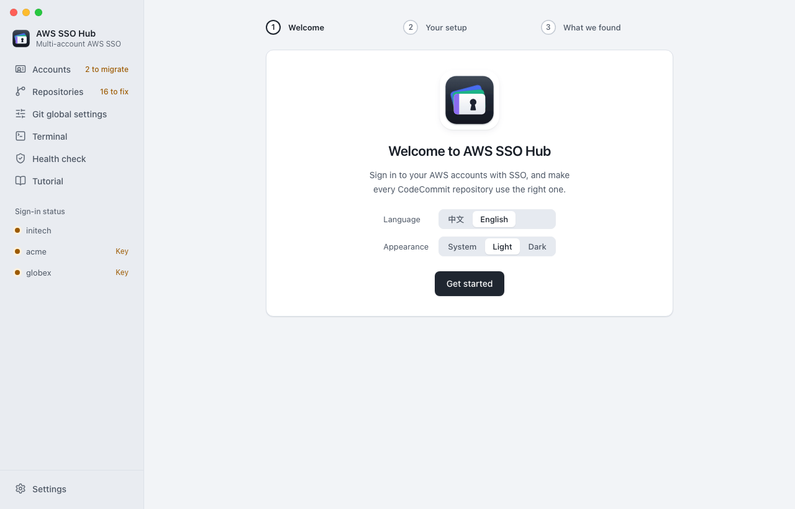

The next step checks your setup: the AWS CLI, Git, and whether the app can read and write your AWS and Git configuration files. If something is missing, install it and choose **Check again**.

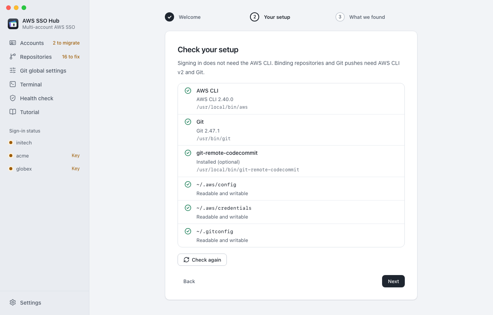

Nothing on your computer changes until you confirm a step. Opening the app only reads your files.

## 3. The Accounts page

**Accounts** is the home page. It reads your existing `~/.aws/config`.

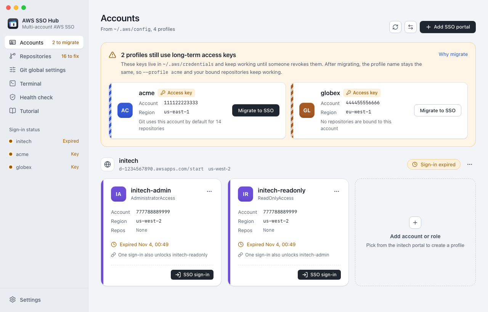

- **The yellow panel** lists profiles that still use long-term access keys (here `acme` and `globex`). Section 6 shows how to move them to SSO.
- **Each SSO portal** has its own section (here `initech`) with a card per profile. Profiles of the same portal share one sign-in, so one click unlocks all of them.
- **Sign-in status** in the sidebar shows every portal at a glance, with the time left.
- Each account gets its own colour and two letters. The same badge appears on the repositories bound to it, so you can see at once which account a repository uses.

## 4. Add an SSO portal

Choose **Add SSO portal** at the top of the Accounts page.

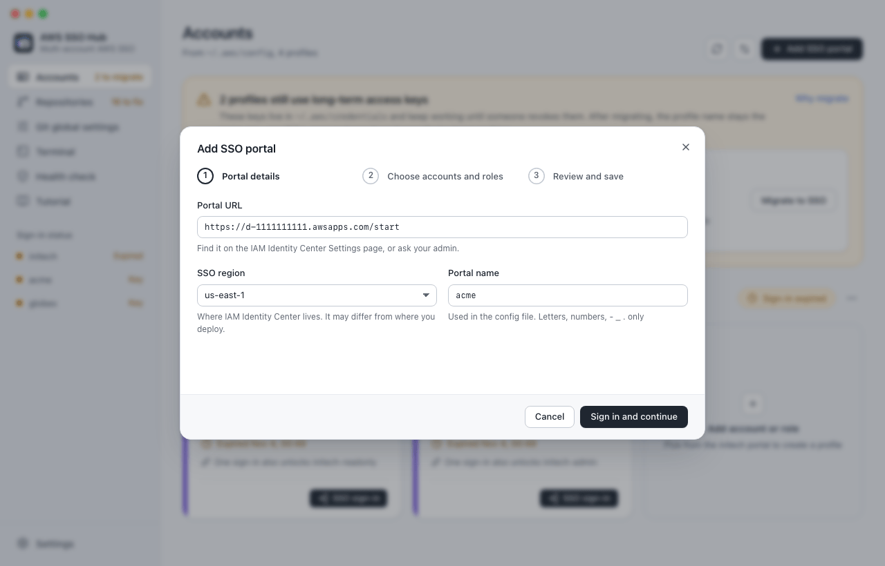

1. **Portal URL:** paste the AWS access portal URL from your administrator.
2. **SSO region:** the region where IAM Identity Center runs. It can differ from the region your resources are in.
3. **Portal name:** a short name used in the config file, for example `acme`.
4. Choose **Sign in and continue**. The browser opens for sign-in (see the next section). Afterwards you choose which accounts and roles to add, review the change, and save. Each account and role becomes a profile in `~/.aws/config`.

## 5. Sign in

Choose **SSO sign-in** on a card (or **Sign in again** later). Your default browser opens the AWS sign-in page. Sign in there and choose **Allow access**. The app waits and continues on its own.

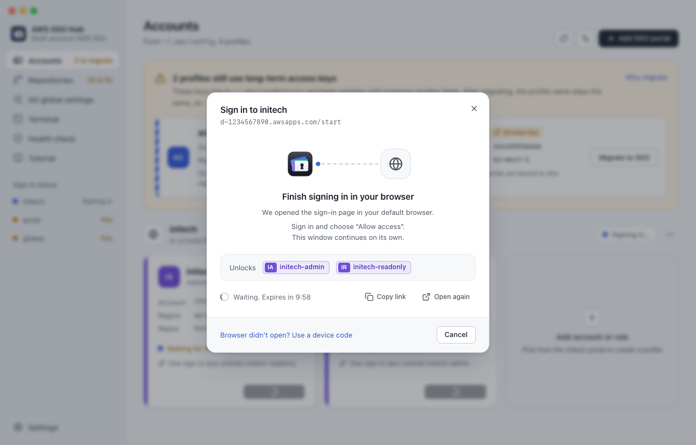

- **Unlocks** shows which profiles this one sign-in covers.
- **Copy link** or **Open again** helps if you use another browser.
- **Browser didn't open? Use a device code** switches to a code you type into the AWS page instead.

When the sign-in is done, every card of that portal shows how long the session has left:

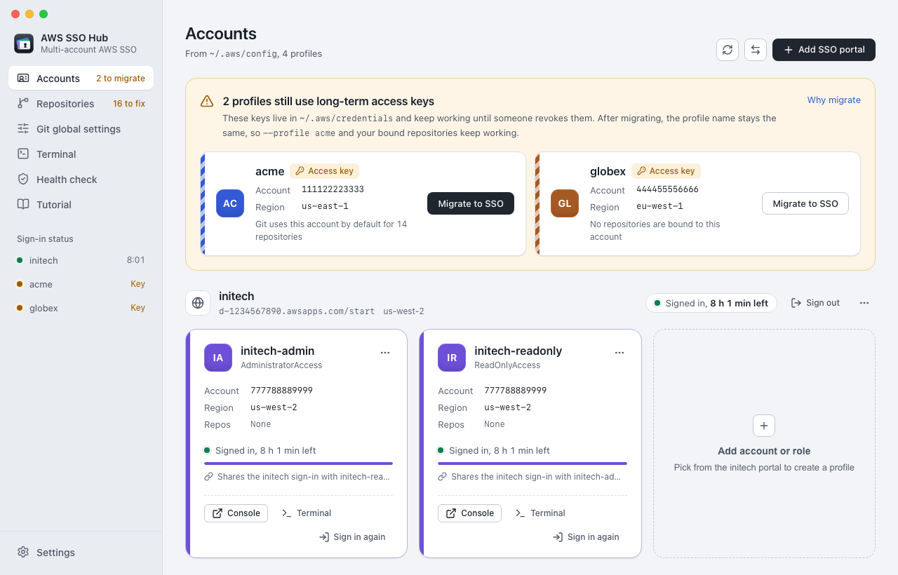

Click the countdown to see the details:

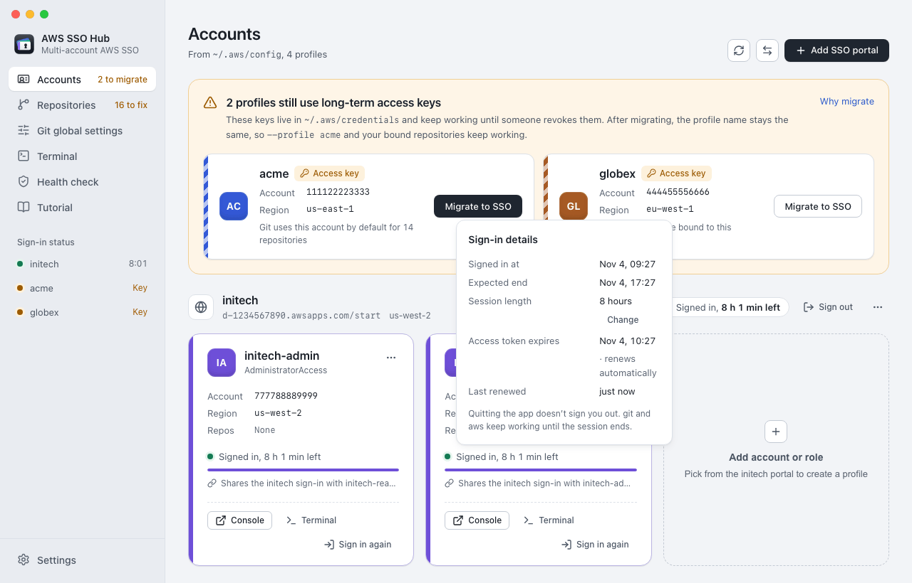

- **Session length** is set by your administrator (8 hours by default). If the countdown does not match, choose **Change** and enter the same length.
- The **access token** inside the session renews itself automatically; you never need to watch it.
- **Quitting the app does not sign you out.** The sign-in is stored where the AWS CLI keeps it, so `git` and `aws` keep working until the session ends, even with the app closed.

**Sign out** on the portal header ends the session on this computer. It also removes the temporary role credentials the AWS CLI cached for that portal, so nothing keeps working in the background. Credentials that AWS already issued stay valid on AWS's side until they expire.

## 6. Move an access-key profile to SSO

Choose **Migrate to SSO** on a profile in the yellow panel. The wizard has seven steps. The profile keeps its name, so `--profile acme`, your scripts and your bound repositories keep working.

**Choose a portal and sign in.** If the account already belongs to a portal you added, pick it. Otherwise fill in a new portal, as in section 4.

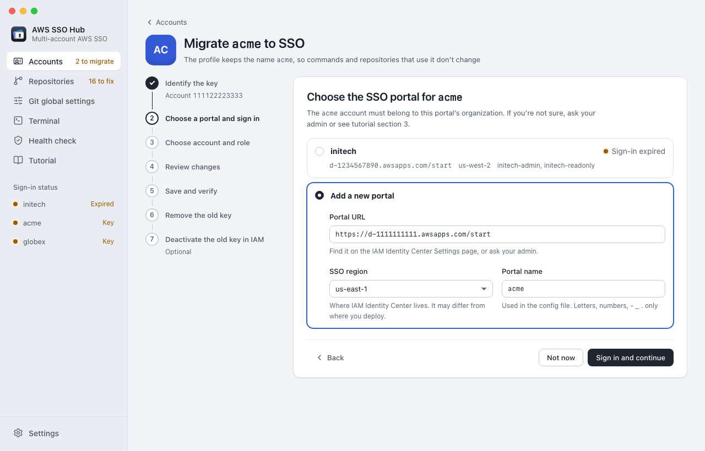

**Choose account and role**, then **Review changes.** The wizard shows the exact lines it will add to `~/.aws/config`. Comments, other profiles and the alignment of your file stay as they are.

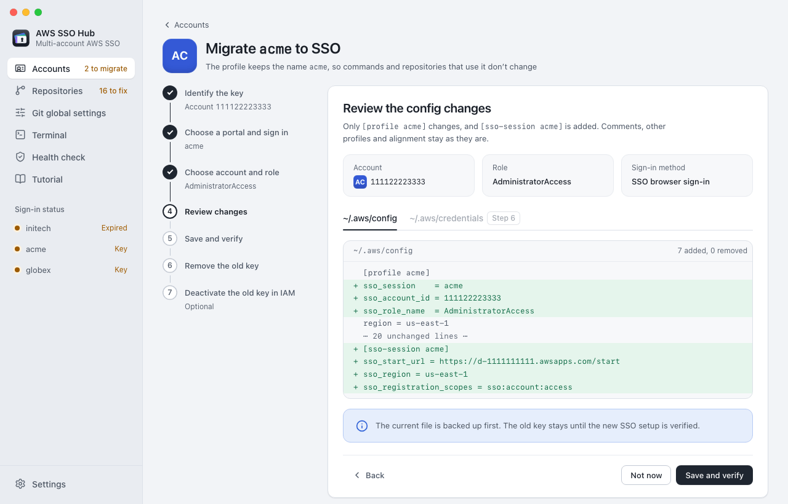

**Save and verify.** The file is backed up first. The app then checks that the new SSO setup really works, using SSO credentials. The old key stays in place until this check succeeds.

**Remove the old key.** The key is removed from `~/.aws/credentials`. The backup of that file never contains key values.

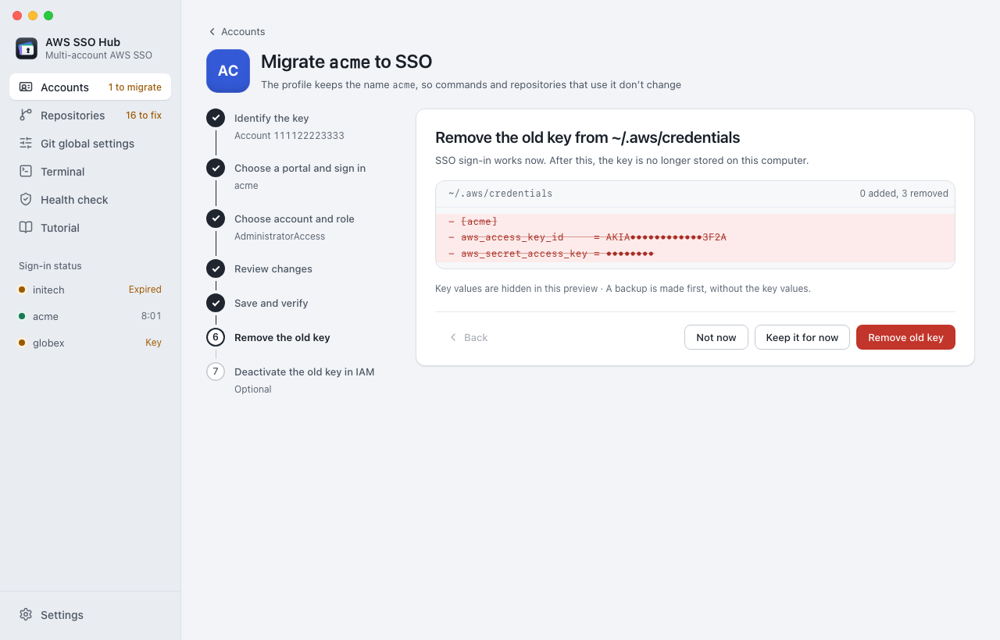

**Deactivate the old key in IAM** (optional, recommended). A copy of the key may still exist somewhere else, so turn it off in AWS too. The app can do this for you when your role is allowed to; otherwise it shows where to do it in the console.

## 7. Bind your repositories

**Repositories** lists every CodeCommit repository found in your scan folders (you can change them in Settings).

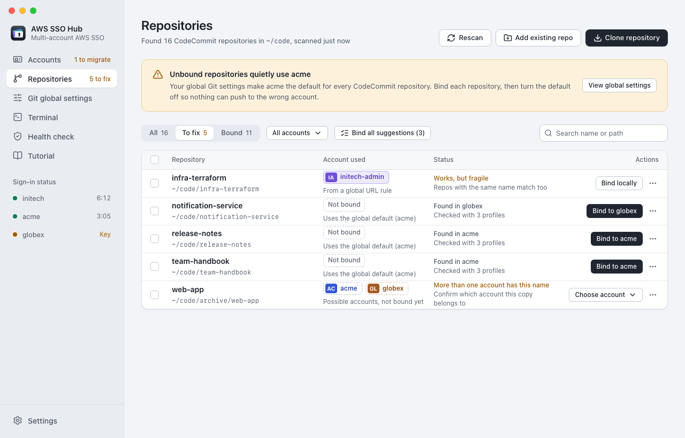

- **To fix** shows repositories that are not bound to an account yet. For each one, the app asks AWS which of your accounts owns it and shows a suggestion such as **Bind to acme**.
- **More than one account has this name**: two accounts have a repository with the same name. Choose **Choose account**; the app can compare commits to help you pick.
- **From a global URL rule** (**Works, but fragile**): the account comes from a rule in your global Git settings that matches by URL. **Bind locally** gives this folder its own binding instead.
- An **SSH** remote cannot use SSO. The row offers to switch it to HTTPS.

Choose **Bind all suggestions** to bind every repository with exactly one suggested account in one go. Repositories with several possible accounts are left for you to decide.

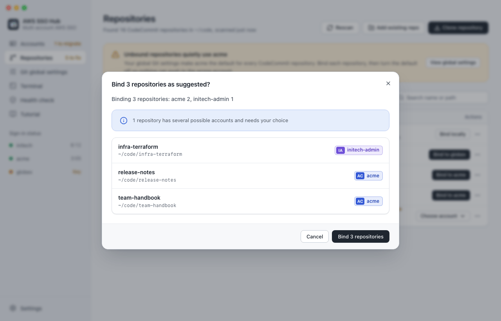

A binding is stored in that repository's own `.git/config`, so two clones of the same repository can use two different accounts. It only applies to the CodeCommit host; other remotes such as GitHub in the same repository are untouched.

## 8. Add an existing repository

Have a clone outside your scan folders? Choose **Add existing repo** and pick its folder. The app finds the owning account, and if exactly one account matches, binds the repository right away. **Undo** in the message reverts it.

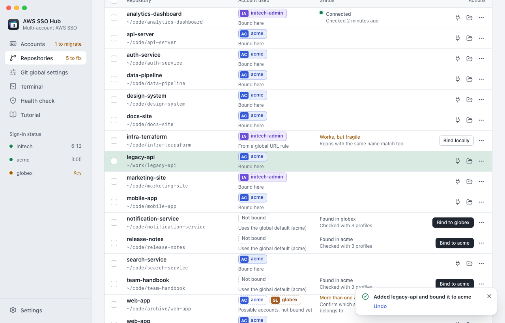

You can turn the automatic binding off in Settings.

## 9. Clone a repository

Choose **Clone repository**, pick the account and region, select the repository, and choose where to save it. The clone is bound to the chosen account from the start.

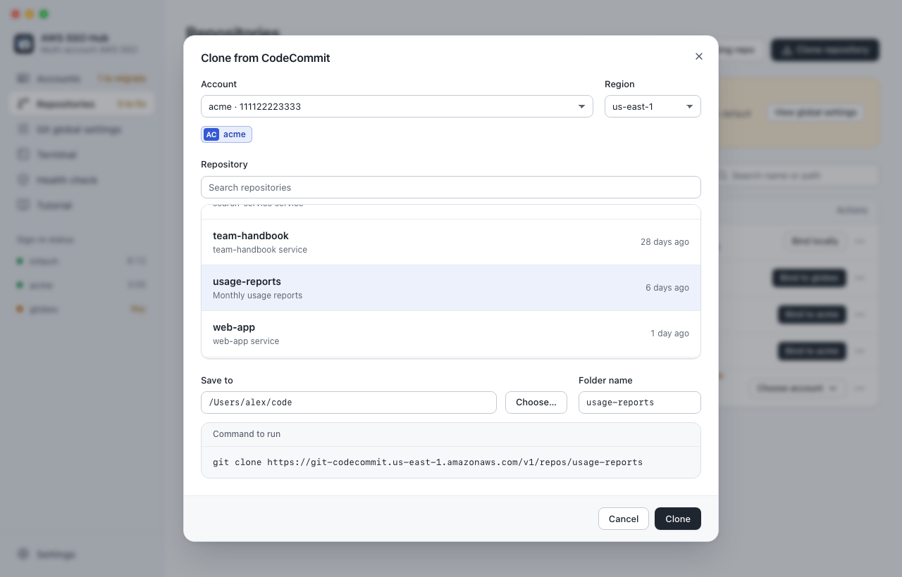

## 10. What Git does when you are not signed in

Git keeps working as long as you are signed in. When the session has ended, Git stops with a clear message instead of asking for a password:

```text
$ git pull
aws: [ERROR]: Error loading SSO Token: Token for acme does not exist
AWS SSO Hub: cannot get CodeCommit credentials for AWS profile 'acme' (not logged in, session expired, or AWS CLI missing). Click 'SSO sign-in' for this profile in AWS SSO Hub, or run: aws sso login --profile acme
fatal: credential helper '!f() { ... }; f' told us to quit
```

Sign in again (in the app, or with the `aws sso login` command shown) and run the Git command again. The first line comes from the AWS CLI and may read differently.

## 11. Git global settings

**Git global settings** looks at settings in `~/.gitconfig` that affect every repository.

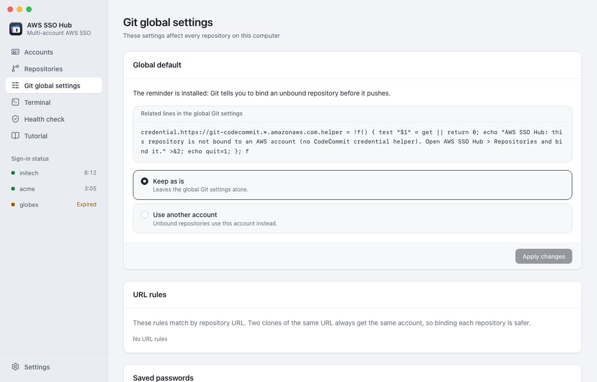

- **Global default:** many setups send every CodeCommit repository to one account through a global helper. Then an unbound repository silently uses that account. The recommended setting replaces it with a reminder: Git asks you to bind the repository before it pushes. The app shows the exact change before applying it.
- **URL rules:** rules that pick an account by repository URL. Binding each repository is safer, because two clones of the same URL always get the same account from a rule.
- **Saved passwords:** old CodeCommit passwords saved in the macOS Keychain or Windows Credential Manager. Clear them if Git keeps using an old login.

## 12. Export and import

Move your setup to another computer, or share it with a teammate. Choose the arrows button next to **Add SSO portal**, or go to Settings.

**Export** lets you pick portals and profiles, then **Copy JSON** or **Save as file…**. The file contains no keys and no sign-in information. Profiles that still use an access key are never exported.

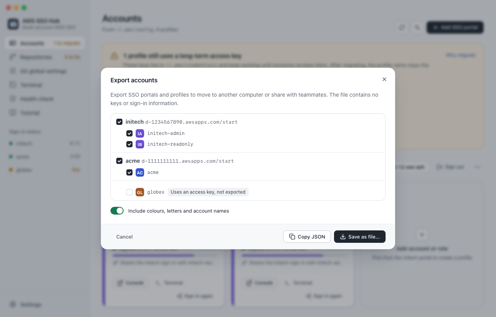

**Import** shows a preview first. Each entry is marked **New**, **Already there**, **Same name, different settings** (choose **Skip**, **Replace** or **Import as** a new name) or **Rejected**. Anything that contains keys or commands is rejected for safety. Below the list you see the exact change to `~/.aws/config`.

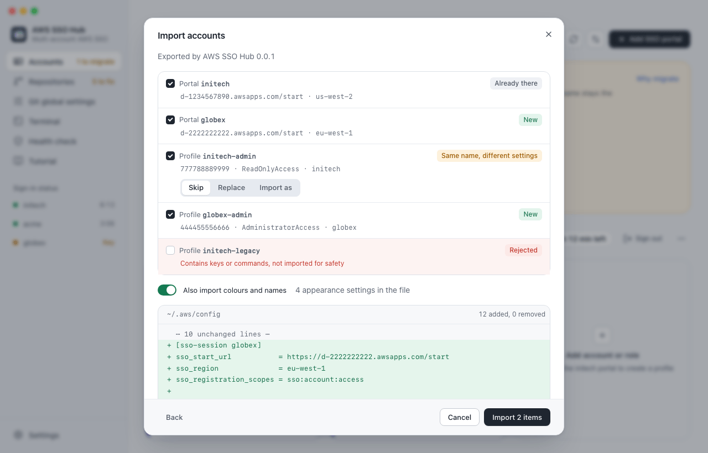

After importing, sign in to each portal. The other person needs their own IAM Identity Center user with access to those accounts.

## 13. Settings

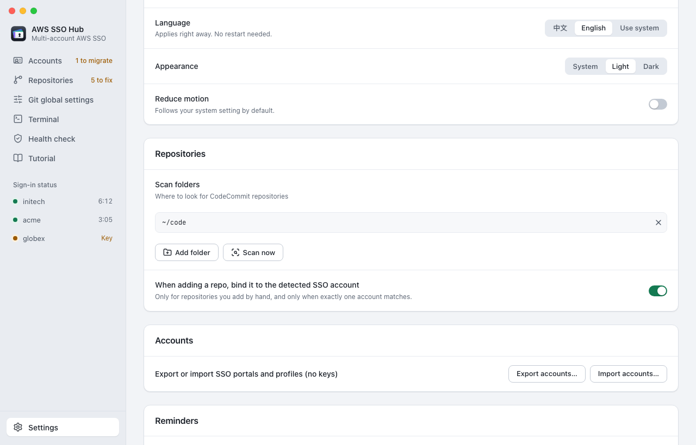

- **Language** (中文 / English / follow the system) and **Appearance** (system / light / dark) apply right away.
- **Scan folders:** where the app looks for repositories.
- **When adding a repo, bind it to the detected SSO account:** the automatic binding from section 8.
- **Accounts:** export and import.
- Further down: sign-in reminders, tool paths for `aws` and `git`, and **Backups**. Every change the app makes is backed up first, without key values, and can be restored from here.

The dark theme:

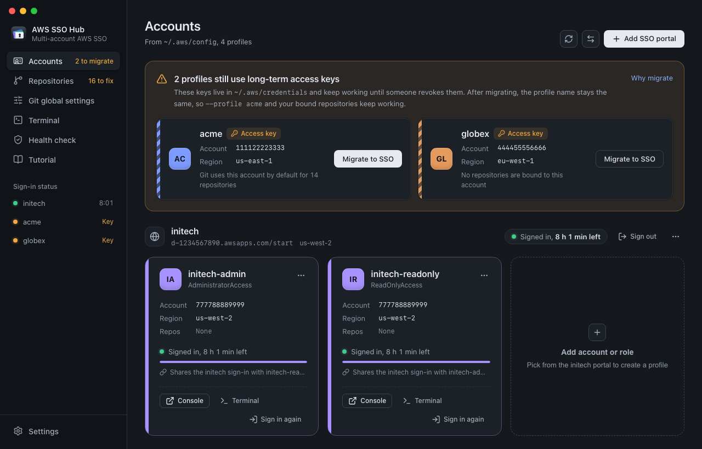

## 14. The built-in tutorial

**Tutorial** in the sidebar covers the same ground inside the app, in both languages, with a checklist to track your progress: the administrator steps first, then the steps for each developer.

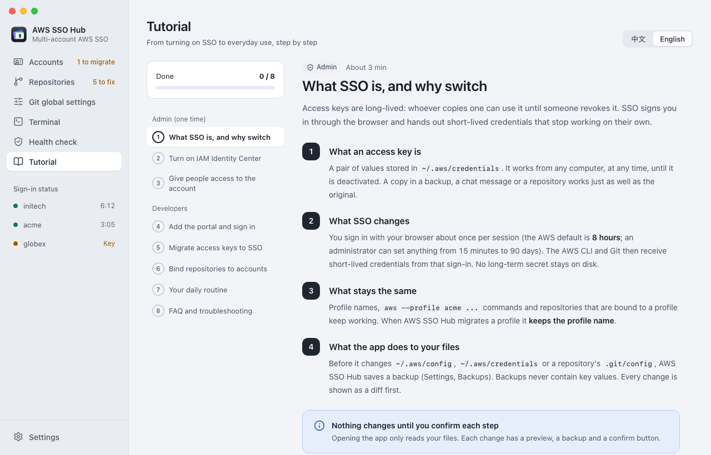

## 15. Everyday routine

1. Start the day: open AWS SSO Hub and choose **SSO sign-in** on the portals you need. The sidebar shows the time left for each.
2. Work as usual: `git pull`, `git push` and `aws --profile acme ...` just work. You can quit the app.
3. **Terminal** opens a terminal with the right `AWS_PROFILE`, or gives you the exact commands to copy.
4. **Console** on a card opens the AWS console for that role.
5. **Health check** points out long-term keys and environment variables that would bypass SSO.

## 16. Troubleshooting

**macOS says the app is damaged or from an unidentified developer.**
The app is not notarized. Use right-click, **Open**, or the `xattr` command from section 2.

**Git asks for a password.**
The repository is probably not bound yet: bind it on the Repositories page. If it is bound and still asks, an old password is saved in the Keychain or Credential Manager: clear it under **Git global settings**, **Saved passwords**.

**Git says it cannot get CodeCommit credentials.**
Your session ended. Choose **SSO sign-in** for that portal.

**The countdown says my session ends earlier or later than it really does.**
The session length is set by your administrator. Click the countdown, choose **Change**, and enter the same length.

**"AWS CLI not found" or "too old".**
Install AWS CLI v2 2.22 or later. If the app still cannot find it, enter the full path under Settings, tool paths.

**Two repositories with the same name in different accounts.**
The row shows both accounts. Choose the right one; comparing commits helps.

**My remote uses SSH.**
SSO works over HTTPS only. Use the switch-to-HTTPS action on the repository row.

**`AWS_ACCESS_KEY_ID` is set in my shell profile.**
Environment variables take priority over profiles, so SSO is never used. **Health check** shows the file and line to remove.

**Where are the backups?**
`~/Library/Application Support/AWS SSO Hub/backups` on macOS and `%AppData%\AWS SSO Hub\backups` on Windows. Settings, **Backups** lists them and restores one.
