# AWS SSO Hub 图文教程

[English](guide.md) | **简体中文** · [返回 README](../README.zh-CN.md)

这份教程带你把 AWS SSO Hub 的每个界面走一遍。所有截图都使用虚构的示例数据：公司名 `acme`、`globex`、`initech`，账号 ID 如 `111122223333`。

## 目录

1. [开始之前](#1-开始之前)
2. [安装与首次打开](#2-安装与首次打开)
3. [账号页面](#3-账号页面)
4. [添加 SSO 门户](#4-添加-sso-门户)
5. [登录](#5-登录)
6. [把访问密钥迁移到 SSO](#6-把访问密钥迁移到-sso)
7. [绑定仓库](#7-绑定仓库)
8. [添加现有仓库](#8-添加现有仓库)
9. [克隆仓库](#9-克隆仓库)
10. [没登录时 git 会怎样](#10-没登录时-git-会怎样)
11. [Git 全局设置](#11-git-全局设置)
12. [导出与导入](#12-导出与导入)
13. [设置](#13-设置)
14. [内置教程](#14-内置教程)
15. [日常使用](#15-日常使用)
16. [常见问题](#16-常见问题)

---

## 1. 开始之前

**电脑上需要**

- macOS 13 或更新版本（Apple 芯片或 Intel），或者 Windows 10/11 x64，并装有 WebView2 运行时。
- [AWS CLI v2](https://docs.aws.amazon.com/cli/latest/userguide/getting-started-install.html) 2.22 或更新版本。只登录的话不需要它，但 git 和 `aws` 命令需要。
- Git 2.39.1 或更新版本。

**AWS 那边（管理员为每家公司做一次）**

AWS SSO Hub 通过 **IAM Identity Center** 登录。如果你们公司还没开通，由管理员在公司的主 AWS 账号里操作。AWS 控制台的菜单名称偶尔会调整，以实际界面为准。

1. 打开 **AWS Organizations**，创建一个组织。单独的账号会自动成为这个组织的管理账号，其他什么都不会变。
2. 打开 **IAM Identity Center**，点击 **Enable（启用）**。先选好区域，之后想换区域只能重新来过。
3. 在 **Users（用户）** 里给每个人建一个用户。对方会收到邮件来设置密码，第一次登录时绑定 MFA。
4. 在 **Permission sets（权限集）** 里新建一个，比如 `AdministratorAccess` 或 `PowerUserAccess`。如果某人只需要用 git，带 `AWSCodeCommitPowerUser` 策略的权限集就够了。
5. 在 **AWS accounts（AWS 账户）** 里选中账号，点 **Assign users or groups（分配用户或组）**，选择用户和权限集。
6. 在 **Settings（设置）** 里复制 **AWS access portal URL（AWS 访问门户地址）**（形如 `https://d-xxxxxxxxxx.awsapps.com/start`），并记下 Identity Center 所在的区域。每个人都需要这两样。
7. 可选：在 **Settings（设置）→ Authentication（身份验证）** 里，**会话时长** 决定登录一次能用多久（默认 8 小时，可以设为 15 分钟到 90 天）。

如果每家公司都有自己的 AWS Organization，就在每家公司各做一遍。这样在 AWS SSO Hub 里，每家公司都是一个独立的门户，各有各的登录按钮。如果所有账号都在同一个组织里，就只有一个门户，里面列出全部账号。

> IAM Identity Center 的「账号实例」不能授权访问 AWS 账号，请使用上面说的组织实例。

## 2. 安装与首次打开

到 [Releases 页面](https://github.com/rudian/aws_sso_hub/releases) 下载对应系统的 zip 包。

- **macOS：** 解压后把 **AWS SSO Hub.app** 拖进「应用程序」。这个 app 没有经过 Apple 公证，第一次打开会被拦下：右键点击 app，选「打开」，再点一次「打开」即可。也可以在终端里运行一次：

  ```sh
  xattr -dr com.apple.quarantine "/Applications/AWS SSO Hub.app"
  ```

- **Windows：** 解压后运行 **AWS SSO Hub.exe**。如果 SmartScreen 弹出警告，点「更多信息」，再点「仍要运行」。

第一次打开会有一个简短的欢迎页。选好语言和外观，点 **开始**。

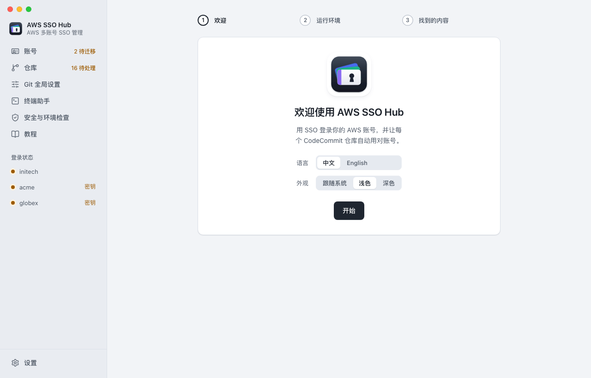

下一步会检查运行环境：AWS CLI、Git，以及能否读写你的 AWS 和 Git 配置文件。缺了什么就先装上，再点 **重新检查**。

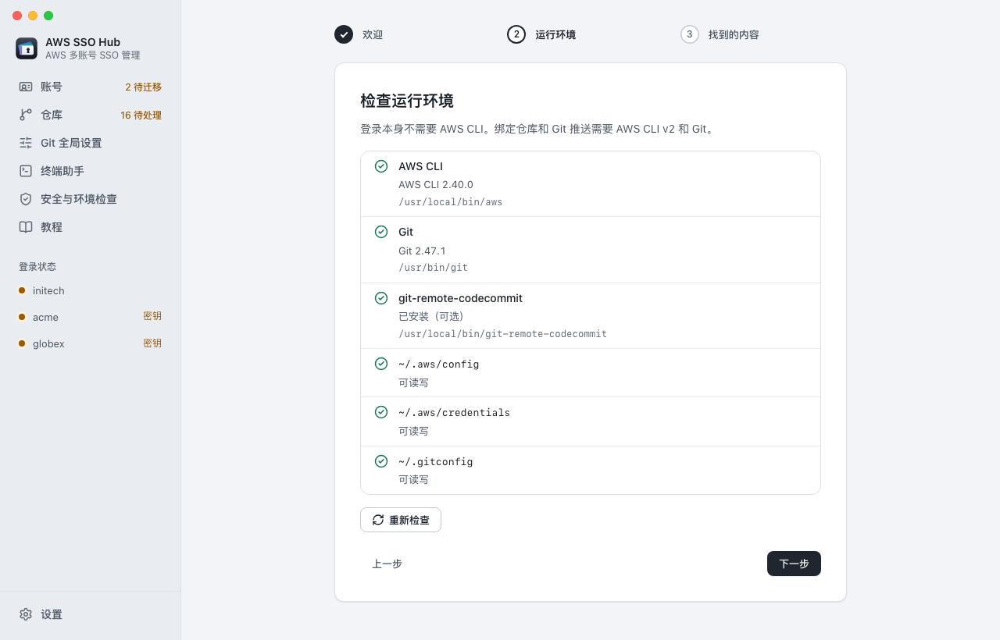

在你确认之前，app 不会改动电脑上的任何东西。打开 app 只会读取文件。

## 3. 账号页面

**账号** 是首页，内容来自你现有的 `~/.aws/config`。

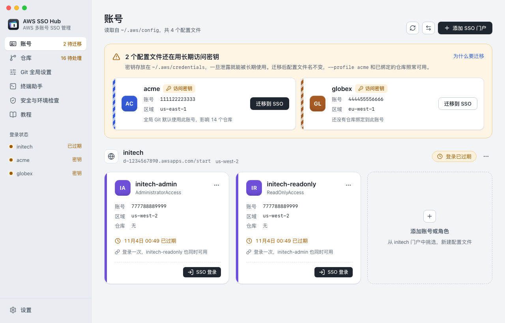

- **黄色区域** 列出还在用长期访问密钥的配置文件（这里是 `acme` 和 `globex`）。第 6 节教你把它们迁移到 SSO。
- **每个 SSO 门户** 单独一块（这里是 `initech`），每个配置文件一张卡片。同一个门户下的配置文件共用一次登录，点一下就全部解锁。
- 左侧的 **登录状态** 一眼就能看到每个门户还剩多少时间。
- 每个账号有自己的颜色和两个字母的标记。绑定到它的仓库也会显示同样的标记，哪个仓库用哪个账号，一看就知道。

## 4. 添加 SSO 门户

在账号页面右上角点 **添加 SSO 门户**。

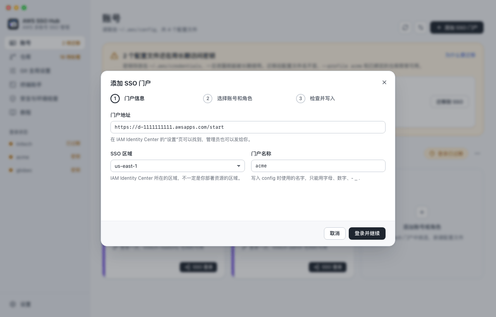

1. **门户地址：** 粘贴管理员给你的 AWS 访问门户地址。
2. **SSO 区域：** IAM Identity Center 所在的区域，不一定是你部署资源的区域。
3. **门户名称：** 写进配置文件用的简短名字，比如 `acme`。
4. 点 **登录并继续**。浏览器会打开登录页（见下一节）。登录后选择要添加的账号和角色，确认改动后保存。每个账号加角色都会变成 `~/.aws/config` 里的一个配置文件。

## 5. 登录

在卡片上点 **SSO 登录**（以后也可以点 **重新登录**）。默认浏览器会打开 AWS 的登录页，登录后点 **允许访问**。app 会一直等着，授权完成后自动继续。

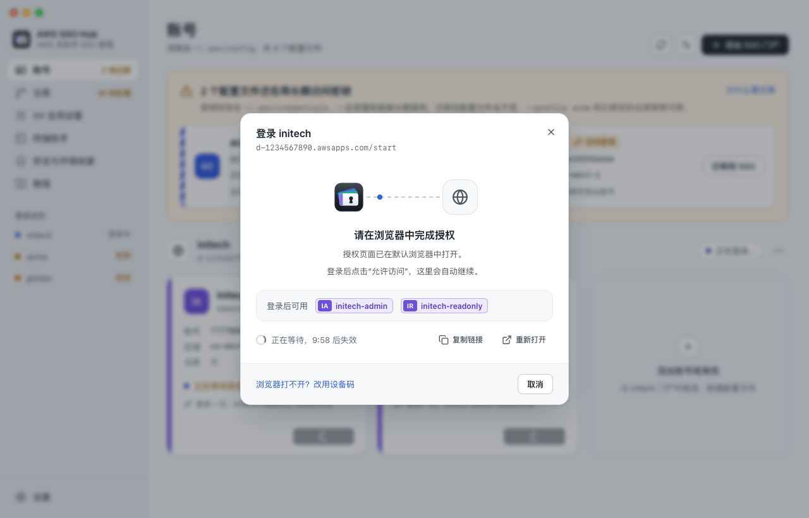

- **登录后可用** 列出这一次登录能解锁哪些配置文件。
- 想换个浏览器登录，可以用 **复制链接** 或 **重新打开**。
- **浏览器打不开？改用设备码**：改成在 AWS 页面上输入验证码的方式。

登录完成后，这个门户的每张卡片都会显示会话还剩多久：

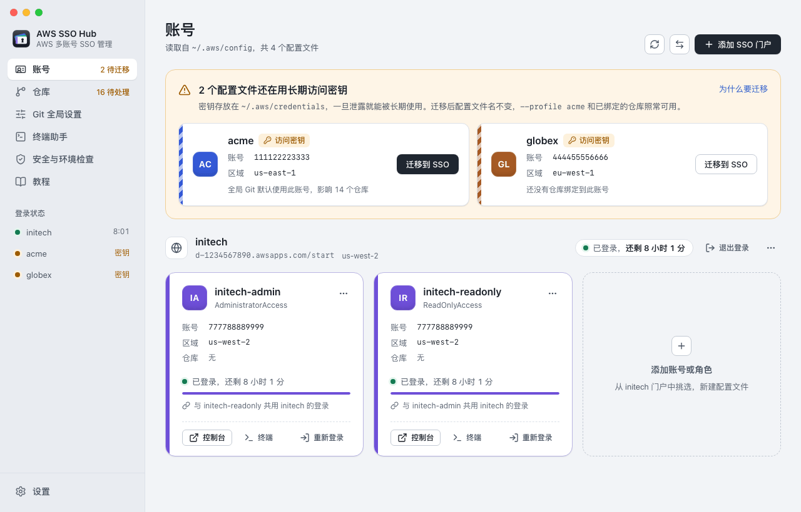

点倒计时可以看详情：

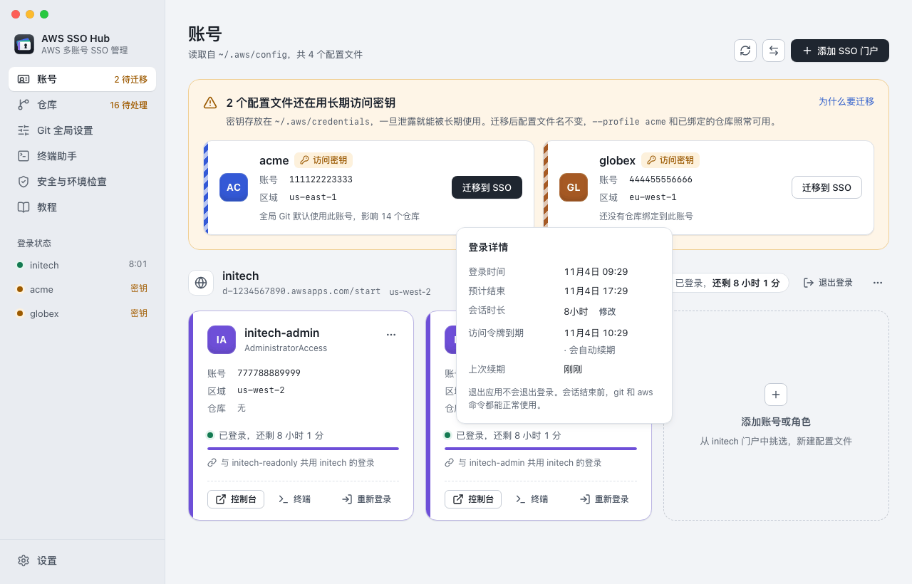

- **会话时长** 由管理员在 IAM Identity Center 中设定（默认 8 小时），app 读不到。app 会根据 AWS 每次续期返回的时间，自动算出会话什么时候结束。第一次登录时，在 AWS 给出结束时间之前，倒计时可能按 8 小时计算。会话不超过 1 小时的，只要设置里的 **自动续期登录** 开着（默认开启），大约 2 分钟内就能发现。
- 会话里的 **访问令牌** 会自动续期，不用管它。
- **退出 app 不会退出登录。** 登录信息存在 AWS CLI 存放它的地方，所以即使关掉 app，在会话结束前 `git` 和 `aws` 命令都照常能用。
- **多个门户可以同时保持登录。** 每个门户有自己的登录和自己的倒计时。

**会话快结束时，登录页会自己打开。** 门户的会话结束前 10 分钟，app 会直接在浏览器里打开登录页，不会先问你。浏览器先显示 app 的一页，写明是哪个门户、这次登录能解锁哪些配置文件，门户多的时候也知道该用哪个账号登录。点 **继续到 AWS 登录**，照常登录，就会开始一个完整时长的新会话。现在不想登录的话，关掉窗口就行，这次会话不会再打开。

- 要等 AWS 告诉 app 会话真正什么时候结束才会打开，所以需要开着设置里的 **自动续期登录**（默认开启）。app 要在运行（窗口或菜单栏都可以）。
- 登录页等着的时候，门户照样是登录状态：倒计时、**控制台**、**终端** 和 Git 都照常能用，卡片上会显示 **登录页已打开**。点卡片上的 **SSO 登录** 会接手，点 **退出登录** 会停掉它。
- 最好开着无痕登录（默认开启）：如果浏览器里还登录着这个门户，AWS 只会给回同一个会话，期限不会延长。
- 旧格式的门户（配置文件里直接写 `sso_start_url`、没有 `sso-session`）不会自动打开。
- 在设置的 **保持登录** 里可以改提前多久（10、15、30 或 60 分钟），也可以关掉。

门户标题旁的 **退出登录** 会结束这台电脑上的会话，同时清掉 AWS CLI 为这个门户缓存的临时角色凭证，确保不会有东西在后台继续能用。已经由 AWS 签发出去的凭证，会在 AWS 那边一直有效到过期为止。

## 6. 把访问密钥迁移到 SSO

在黄色区域里，对某个配置文件点 **迁移到 SSO**。向导一共 7 步。配置文件的名字保持不变，所以 `--profile acme`、你的脚本和已绑定的仓库都不用改。

**选择门户并登录。** 如果这个账号已经在某个门户里，直接选它；否则像第 4 节那样填一个新门户。

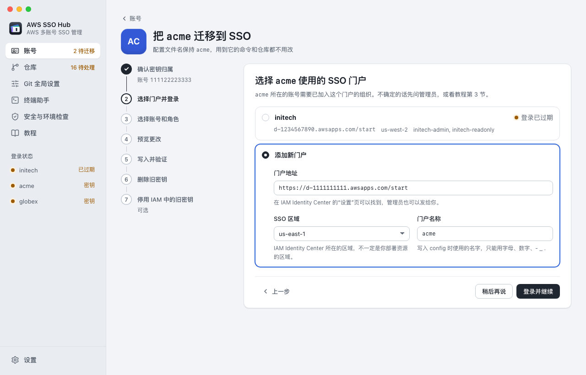

**选择账号和角色**，然后 **预览更改**。向导会列出要往 `~/.aws/config` 里加的每一行。注释、其他配置文件和原来的对齐方式都保持原样。

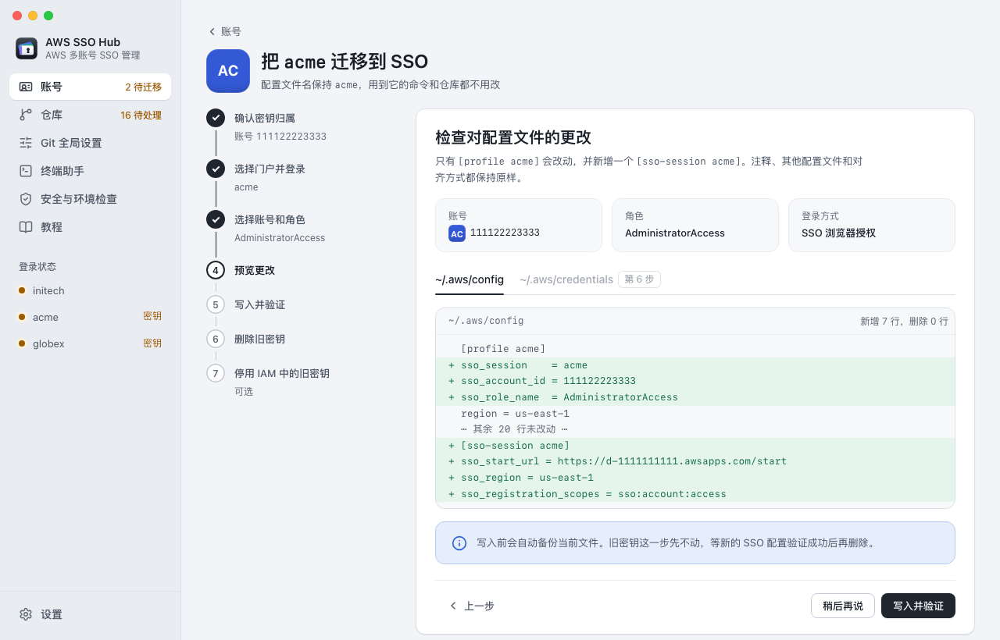

**写入并验证。** 先备份文件，然后 app 用 SSO 凭证实际验证新配置能不能用。验证成功之前，旧密钥不会动。

**删除旧密钥。** 把密钥从 `~/.aws/credentials` 里删掉。这个文件的备份里也不会保存密钥本身。

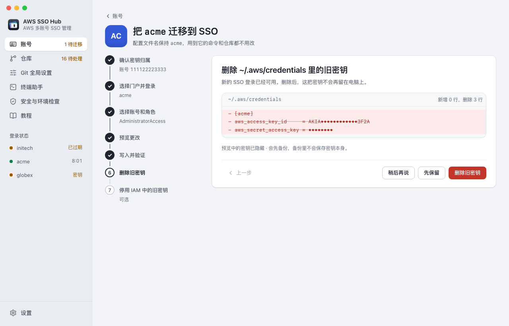

**停用 IAM 中的旧密钥**（可选，建议做）。密钥可能还有拷贝留在别的地方，所以在 AWS 上也把它停用。如果你的角色有权限，app 可以直接帮你停用；没有权限的话，它会告诉你在控制台的哪里操作。

## 7. 绑定仓库

**仓库** 页面列出扫描文件夹里找到的所有 CodeCommit 仓库（扫描哪些文件夹可以在设置里改）。

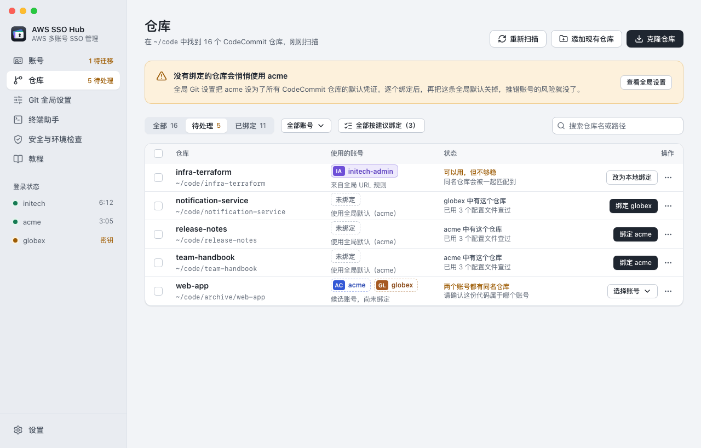

- **待处理**：还没绑定账号的仓库。app 会向 AWS 查询它属于你的哪个账号，并给出建议，比如 **绑定 acme**。
- **两个账号都有同名仓库**：两个账号里有同名的仓库。点 **选择账号** 自己选，app 也可以帮你比对提交记录。
- **来自全局 URL 规则**（**可以用，但不够稳**）：账号来自全局 Git 设置里按地址匹配的规则。点 **改为本地绑定**，让这个文件夹有自己的绑定。
- 用 **SSH** 地址的仓库无法使用 SSO，这一行会提示你改成 HTTPS。

点 **全部按建议绑定**，一次绑好所有只有一个候选账号的仓库。有多个候选账号的仓库会留给你自己决定。

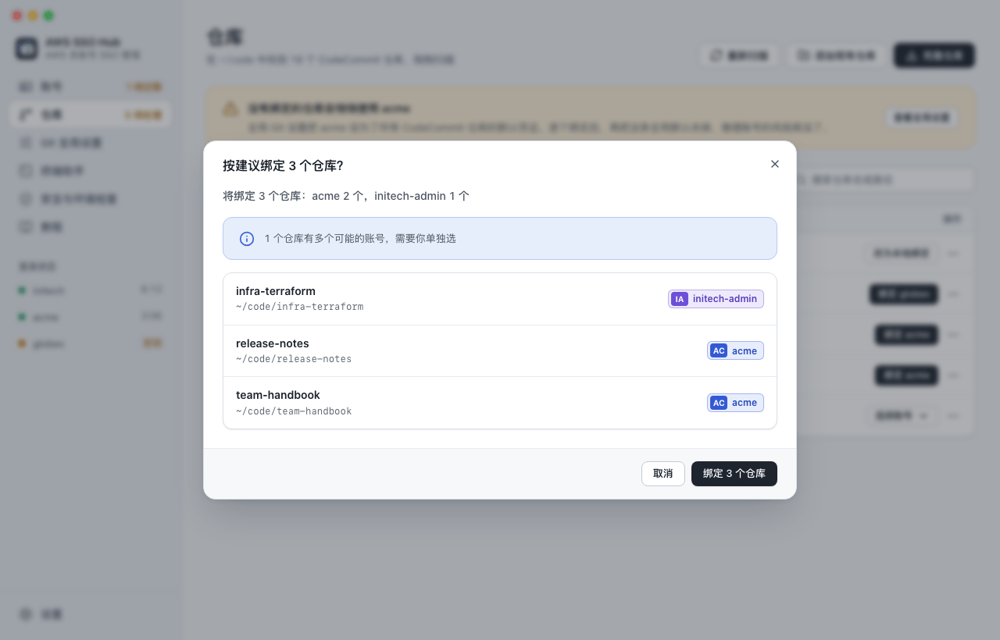

绑定信息写在这个仓库自己的 `.git/config` 里，所以同一个仓库的两份拷贝可以用两个不同的账号。绑定只对 CodeCommit 地址生效，同一个仓库里的其他远程（比如 GitHub）不受影响。

## 8. 添加现有仓库

有仓库不在扫描文件夹里？点 **添加现有仓库**，选择它的文件夹。app 会找出它属于哪个账号，如果只有一个账号匹配，就直接帮你绑定好。提示里的 **撤销** 可以退回。

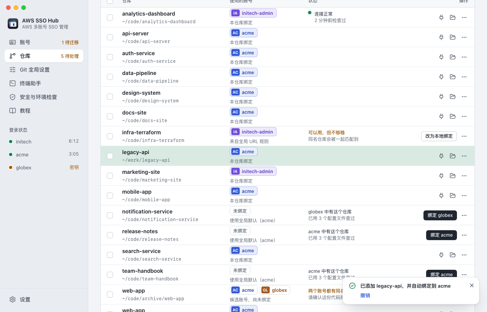

自动绑定可以在设置里关掉。

## 9. 克隆仓库

点 **克隆仓库**，选好账号和区域，选中要克隆的仓库，再选保存位置。克隆下来的仓库从一开始就绑定到选中的账号。

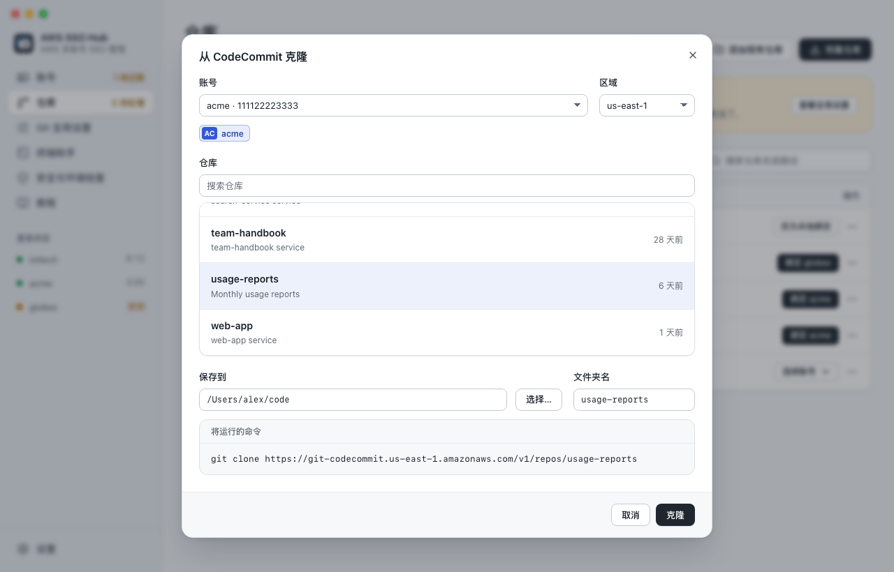

## 10. 没登录时 git 会怎样

登录状态下 git 一切照常。会话结束后，git 会直接给出清楚的提示并停下，而不是让你输密码：

```text
$ git pull
aws: [ERROR]: Error loading SSO Token: Token for acme does not exist
AWS SSO Hub: 无法获取 AWS 配置文件 'acme' 的 CodeCommit 凭证（未登录、登录已过期或缺少 AWS CLI）。请在 AWS SSO Hub 中点击该配置文件的“SSO 登录”，或运行: aws sso login --profile acme
fatal: credential helper '!f() { ... }; f' told us to quit
```

重新登录（在 app 里，或者运行提示里的 `aws sso login` 命令），再执行一次 git 命令就好。第一行来自 AWS CLI，具体内容可能略有不同。

## 11. Git 全局设置

**Git 全局设置** 检查 `~/.gitconfig` 里会影响所有仓库的设置。

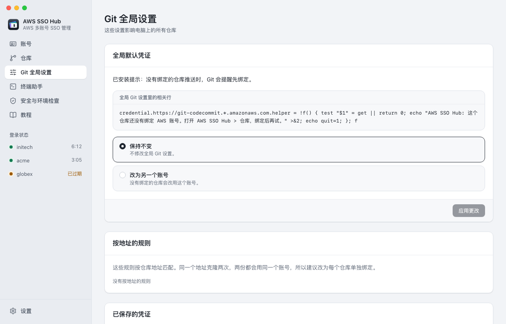

- **全局默认凭证：** 很多配置会用一个全局凭证助手，把所有 CodeCommit 仓库都交给同一个账号。这样没绑定的仓库就会悄悄用上这个账号。推荐的做法是把它换成一条提醒：推送之前，git 会先提醒你绑定这个仓库。应用之前，app 会先给你看具体改动。
- **按地址的规则：** 按仓库地址选择账号的规则。逐个仓库绑定更稳，因为同一个地址克隆两份，规则只能给出同一个账号。
- **已保存的凭证：** 以前存在 macOS 钥匙串或 Windows 凭据管理器里的 CodeCommit 密码。如果 git 一直在用旧的登录，就把它们清掉。

## 12. 导出与导入

把配置搬到另一台电脑，或者分享给同事。点 **添加 SSO 门户** 旁边的双箭头按钮，或者到设置里操作。

**导出**：勾选要导出的门户和配置文件，然后 **复制 JSON** 或 **保存为文件…**。文件里没有任何密钥或登录信息。还在用访问密钥的配置文件永远不会被导出。

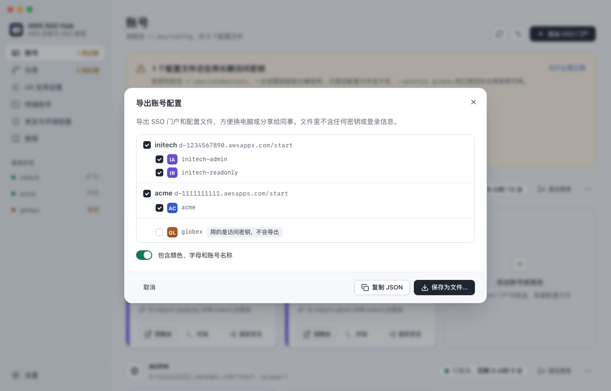

**导入**：先显示预览。每一项会标成 **新增**、**已存在**、**同名但内容不同**（可选 **跳过**、**覆盖** 或 **改名导入**）或 **已拒绝**。含有密钥或命令的内容一律拒绝导入。列表下方是 `~/.aws/config` 的具体改动。

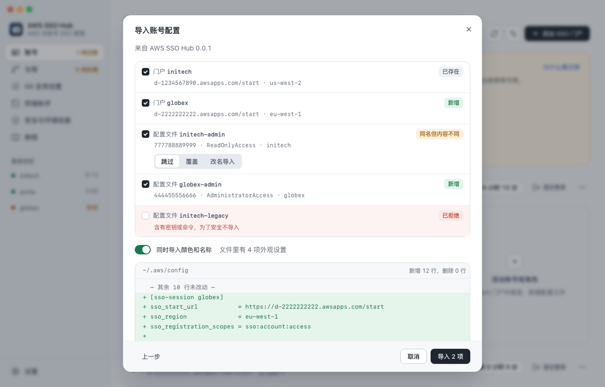

导入后，逐个门户登录即可。对方需要有自己的 IAM Identity Center 用户，并且有这些账号的访问权限。

## 13. 设置

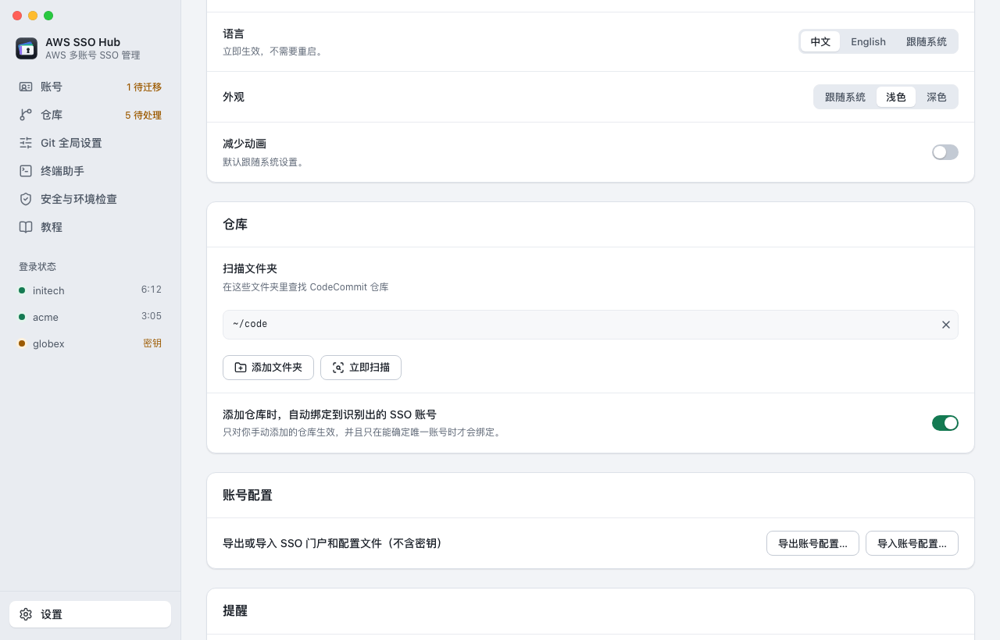

- **语言**（中文 / English / 跟随系统）和 **外观**（跟随系统 / 浅色 / 深色）立即生效。
- **扫描文件夹：** app 去哪里找仓库。
- **添加仓库时，自动绑定到识别出的 SSO 账号：** 也就是第 8 节的自动绑定。
- **账号配置：** 导出与导入。
- 再往下：**保持登录**（会话快结束时自动打开登录页、提前多久；自动续期登录）、`aws` 和 `git` 的路径，以及 **备份**。app 的每次改动都会先备份（不含密钥），可以在这里恢复。

深色外观：

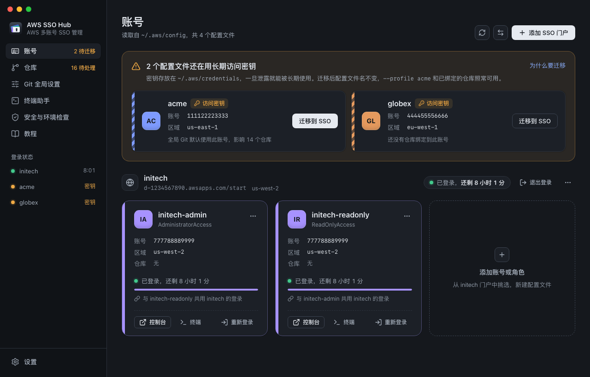

## 14. 内置教程

侧边栏的 **教程** 在 app 里讲同样的内容，中英文都有，还带勾选清单记录进度：先是管理员的步骤，再是每位开发者的步骤。

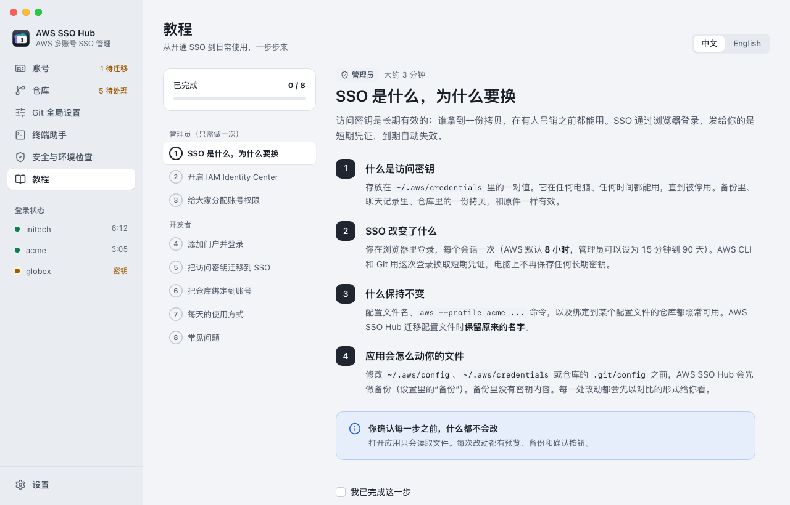

## 15. 日常使用

1. 每天开工：打开 AWS SSO Hub，在需要的门户上点 **SSO 登录**。左侧会显示每个门户还剩多久。
2. 照常干活：`git pull`、`git push`、`aws --profile acme ...` 都能直接用。app 可以关掉。
3. **终端助手** 可以打开一个已经设好 `AWS_PROFILE` 的终端，或者给你可以直接复制的命令。
4. 卡片上的 **控制台** 会用这个角色打开 AWS 控制台。
5. **安全与环境检查** 会指出会绕过 SSO 的长期密钥和环境变量。

**控制台经代理打开（macOS）。** 有些组织只允许从固定的出口 IP（比如 VPN）访问 AWS。遇到这样的门户，点门户标题上的 **…**，选 **控制台经代理打开…**，填 HTTP 代理，格式为 `主机:端口`（例如 `10.0.0.1:3128`）。之后门户标题会显示这个代理，点 **控制台** 会打开一个单独的 Google Chrome：访问 AWS 的流量经代理，其他网站直连。连不上代理时，AWS 页面打不开，不会改为直连 AWS。想改回默认浏览器，在同一个对话框里点 **关闭代理**。

## 16. 常见问题

**macOS 提示 app 已损坏，或来自身份不明的开发者。**
这个 app 没有经过 Apple 公证。右键点击选「打开」，或者用第 2 节的 `xattr` 命令。

**控制台提示没有权限，并带有 “explicit deny”。**
你们组织可能只允许从固定的出口 IP（比如公司 VPN）访问 AWS，而默认浏览器是直连的。连上 VPN，再给这个门户设置控制台代理（见第 15 节的 **控制台经代理打开**）。

**git 让我输入密码。**
多半是这个仓库还没绑定：到仓库页面绑定它。如果已经绑定还是要密码，说明钥匙串或凭据管理器里存着旧密码：到 **Git 全局设置 → 已保存的凭证** 清掉。

**git 提示无法获取 CodeCommit 凭证。**
会话已经结束。在对应门户上点 **SSO 登录**。

**倒计时比实际会话早结束或晚结束。**
会话时长由管理员设定，app 读不到。app 会根据 AWS 每次续期返回的时间算出真正的结束时间，倒计时会自己校正。第一次登录时，在 AWS 给出结束时间之前，倒计时可能按 8 小时计算。会话不超过 1 小时的，只要设置里的 **自动续期登录** 开着（默认开启），大约 2 分钟内就能发现。

**提示找不到 AWS CLI，或版本太旧。**
安装 AWS CLI v2 2.22 或更新版本。如果 app 还是找不到，在设置里填上它的完整路径。

**两个账号里有同名仓库。**
这一行会同时显示两个账号。选对的那个，可以借助比对提交记录来判断。

**我的远程地址是 SSH。**
SSO 只支持 HTTPS。用仓库这一行上的改为 HTTPS 操作。

**我的 shell 配置里设置了 `AWS_ACCESS_KEY_ID`。**
环境变量的优先级高于配置文件，SSO 永远不会生效。**安全与环境检查** 会告诉你是哪个文件的哪一行，删掉即可。

**备份在哪里？**
macOS 在 `~/Library/Application Support/AWS SSO Hub/backups`，Windows 在 `%AppData%\AWS SSO Hub\backups`。在 **设置 → 备份** 里可以查看和恢复。
